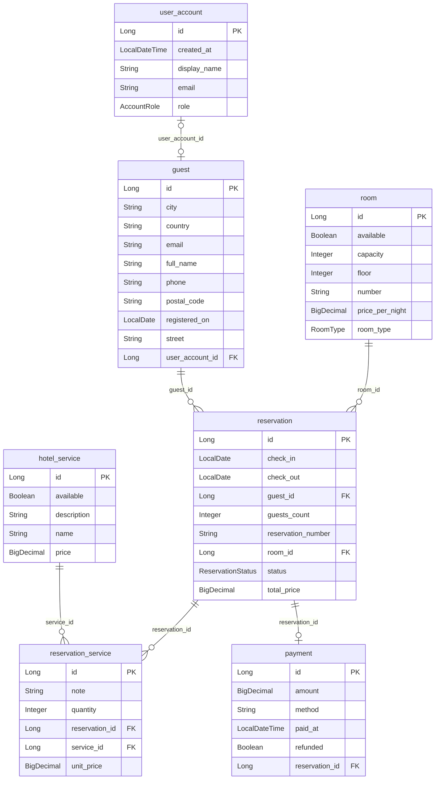

# Schemat bazy danych

Plik generują reguły projektu (panel Maven → Lifecycle → verify). Nie edytujcie go ręcznie.

Tabele: 7 · kolumny: 48 · relacje: 4 × @ManyToOne, 2 × @OneToMany, 2 × @OneToOne, 0 × @ManyToMany

| Tabela | Encja | Kolumny | Klucze obce |
|---|---|---|---|
| guest | Guest | 10 | user_account_id |
| hotel_service | HotelService | 5 | — |
| payment | Payment | 6 | reservation_id |
| reservation | Reservation | 9 | guest_id, room_id |
| reservation_service | ReservationService | 6 | reservation_id, service_id |
| room | Room | 7 | — |
| user_account | UserAccount | 5 | — |

